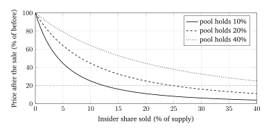
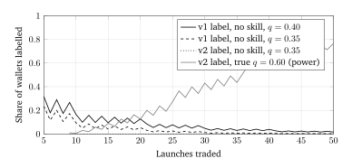

# Calibrated Launch Integrity: A Verifiable, Manipulation-Aware Scoring Protocol for Newly Launched Tokens

Oct 7, 2026 · @7

*Working paper prepared for Drydock Org. It has not been through external peer review. No Arc outcome data were available to the author, so every empirical claim about the proposed design is stated as a hypothesis with a test.*

## Abstract

Scores that screen newly launched tokens are widely used and almost never validated. We audit the published DryDock score for Arc launches (v1), an additive 0 to 100 index of seven weighted factors with four hard caps \[1\], and report twelve findings. The published weights sum to 90, not 100. The score has no stated estimand, so it cannot be tested. Market-activity factors carry 44% of attainable points, although insiders can manufacture activity and it peaks when entry risk peaks. Insider concentration is thresholded on supply share alone, yet the price impact of an insider exit depends on that share relative to pool depth: under a constant-product pool a 15% stake implies a 47% or an 84% price drop depending on the pool's share of supply. The "profitable trader" wallet label is awarded to 16% to 32% of no-skill wallets at five launches. Under a stated interpolation assumption, a launch whose measured insider share is 20% still scores 76 ("Strong setup") while that cluster's exit would cut a buyer's position by 89%.

We then specify v2. It replaces points with three quantities that carry units. The *structural floor* is the recovery of a $100 reference position under the worst single structural event available at a given block, computed by simulation. *Channel probabilities* are forecasts of three resolvable on-chain events (tradability loss, liquidity removal, insider exit), calibrated against outcomes. The *Integrity Score* is 100 minus their expected loss. Insider holdings are reported as an identified interval whose pessimistic bound cannot be lowered by Sybil splitting. Price momentum is excluded from the score by construction. Forecasts are committed on-chain before outcomes and scored in public with proper scoring rules. We give five propositions, an eleven-attack analysis, a pre-registered validation protocol with sample sizes, and explicit ship and kill criteria.

**Keywords:** token launches, rug pulls, probabilistic forecasting, calibration, proper scoring rules, strategic classification, Sybil resistance, entity resolution, automated market makers, verifiable computation.

## 1. Introduction

### 1.1 The problem

Most new tokens fail, and most fail fast. Xia et al. flagged over 10,000 scam tokens on Uniswap V2, roughly half of all listings \[5\]. Cernera et al. found that about 60% of tokens on Ethereum and BNB Chain are active for less than a day and estimated $240 million in profits from one-day rug pulls \[7\]. On Pump.fun, 0.63% of 655,770 tokens launched in September 2025 graduated, and 92.2% of tokens with at least 30 swaps showed a dump event \[10\]. An industry study reported by The Defiant put the share of Pump.fun launches that collapse at 98.6% \[14\].

Buyers decide in seconds, so a single number does most of the work. That number is usually an additive point score built from heuristics. A survey of 14 rug-pull detection tools found they cover 25 of 34 known root causes and miss wash trading, hidden fees and fake liquidity locks \[8\]. We found no launch-scoring product that publishes calibration against outcomes.

DryDock scores every launch from six launchpads on Arc \[3\]. Arc is Circle's EVM Layer 1; public mainnet opened on 16 September 2026 with USDC as gas and block times near half a second \[57\]. The chain was three weeks old on the date of this paper. Any score for it starts with almost no local outcome history.

### 1.2 The thesis

A launch score should be a forecast, and the cheapest way to raise it should be to make the launch safer. A forecast has an estimand, a unit, a resolution rule, a stated uncertainty and a public track record. A score with those properties can be wrong in a way anyone can measure. A score without them can only be believed or ignored.

This is the standard DryDock's own research applies to launches. The verifiable-launch paper states that the mechanism "proves process, never quality" and labels every guarantee with its trust tier \[4\]. We apply the same discipline to the score: say exactly what is measured, compute it from public state, and make the rest a testable probability.

### 1.3 Contributions

1. An audit of the published v1 methodology with twelve findings, each backed by arithmetic, a closed-form result or cited evidence (Section 3).
2. A scoring protocol, v2, built on three unit-bearing quantities: a simulated structural floor, calibrated channel probabilities and an expected-loss Integrity Score (Section 5).
3. A manipulation-resistance analysis covering eleven attacks, with five propositions on what an adversary can and cannot move (Section 6).
4. A pre-registered validation protocol with baselines, metrics, sample sizes, and ship and kill criteria (Section 7).
5. A verifiability scheme in which forecasts are committed on-chain before outcomes resolve, so the track record cannot be edited after the fact (Section 9).

### 1.4 Method and scope

The audit covers the methodology, risk and launchpad pages as published on 7 October 2026 \[1, 2, 3\]. They were re-read on 8 October 2026 and had not changed; the methodology page still carried its 1 October date. We had no access to the implementation, to per-token scores or to Arc trade data. Where the published text leaves a rule unspecified, we state the assumption we made and show how the result depends on it.

Every number we computed is reproduced by the script in Appendix B. Parameters of v2 that require outcome data are left as symbols or marked as priors. The paper does not claim that v2 predicts better than v1 on Arc. It specifies the experiment that would show whether it does.

## 2. Background and related work

### 2.1 Measuring launch fraud

The measurement literature agrees on scale and disagrees on labels. Xia et al. combined a guilt-by-association heuristic with a classifier and put the scam share of Uniswap V2 listings near 50% \[5\]. Mazorra et al. reported accuracy of 0.9936 for predicting malicious tokens before the malicious act \[6\]. A figure derived from that work, that 97.7% of Uniswap V2 tokens were rug pulls, was publicly contested, and the lead author said the paper's aim was detection method, not prevalence \[59\].

The lesson for a scoring system is that the outcome definition decides the headline. Naviglio et al. show a large share of new-token liquidity trapped in honeypots \[9\]. Mongardini and Mei studied 34,988 meme coins on four chains and found that 82.8% of tokens returning over 100% showed artificial growth, with extraction following earlier manipulation \[13\]. A score must therefore define its failure event mechanically, so that two parties with the same chain data label the same token the same way.

### 2.2 What predicts launch outcomes

Marino et al. model the probability that a Pump.fun token graduates, conditional on bonding-curve state and trader composition \[10\]. Fast accumulation in few trades is the strongest predictor. Bot-dominated activity predicts lower graduation odds. The presence of previously profitable traders adds "at most a modest and nonmonotonic effect." They build every conditioning variable from information available at the decision point and propose a hazard-rate formulation as the natural extension.

Ding, Luo and Xu sample 6,000 Pump.fun projects and separate manipulation tactics \[11\]. Creator-controlled wallets buy in the creation block in 24% of projects, and snipers buy within five blocks in 84%. Creators start the dump in about half of projects. Among traders with statistically significant positive returns, 19.2% are creators and 16.0% are snipers, against 0.8% and 1.0% among consistent losers.

Luo et al. prove an imitation penalty: a copier who trades immediately after a profitable wallet on a bonding curve earns strictly less than that wallet \[12\]. In their test set, copier returns were negative under all three statistical models even though the copied wallets were profitable.

### 2.3 Fabricated activity

Wash trading is cheap, common and effective at attracting buyers. Victor and Weintraud identified $159 million of wash trades on two early decentralized exchanges, affecting over 30% of tokens \[16\]. Cong et al. estimate that wash trades averaged more than 70% of reported volume on unregulated centralized exchanges \[17\]. Ding et al. give causal evidence at the launch level: adopting a wash-trading bot raises the number of participating traders by about 98% within the event window, and a comment bot by about 116%, with no gain in average trader profit \[11\].

### 2.4 Entity resolution and Sybils

An address is not a person. Bitcoin clustering by shared spending \[19\] and Ethereum heuristics based on deposit-address reuse, airdrop participation and token authorisations \[20\] recover some of the mapping. Douceur showed that without a trusted identity authority, one party can always present many identities \[21\]. Industry analysis of Pump.fun found deployer-funded same-block snipers on more than 15,000 tokens in a month using direct funding links only, and documented multi-hop funding chains that the direct method missed \[15\].

Clustering therefore gives a lower bound on common control. The econometric response to a quantity that data cannot pin down is partial identification: report the set of values consistent with the evidence, not a point \[22\]. Section 5.3 applies that idea to insider holdings.

### 2.5 Forecasts, calibration and uncertainty

A probability forecast is calibrated when events assigned probability *p* occur with frequency *p*. The Brier score \[23\] and logarithmic score are strictly proper: a forecaster minimises expected loss only by reporting true beliefs \[25\]. Murphy's decomposition splits the Brier score into reliability, resolution and uncertainty, which separates honest probabilities from useful ones \[24\].

Raw model scores are rarely calibrated. Platt scaling \[26\], isotonic regression \[27\] and their comparison \[28\] are standard remedies, and clinical prediction research treats calibration as the property most often neglected \[29, 30\]. Venn-Abers predictors output a probability interval with a validity guarantee under exchangeability \[31\], and adaptive conformal inference maintains coverage under distribution shift \[32\].

### 2.6 Scores that change what they measure

Goodhart's observation that a measure used as a target loses its meaning \[36\] has a formal literature. Strategic classification models agents who alter features at a cost to obtain a better label \[33\]. Kleinberg and Raghavan distinguish gaming from improvement and characterise scoring rules that induce the latter \[34\]. Performative prediction studies forecasts that shift the distribution they forecast \[35\]. In credit ratings, a rater whose revenue depends on the rated party's activity faces a documented incentive to inflate \[52\].

### 2.7 Composite indices and existing tools

The OECD handbook on composite indicators requires a theoretical framework, justified weights and a sensitivity analysis before a weighted sum is published \[37\]. Dawes showed that even unit-weighted linear models predict well, but only when a criterion variable defines what is being predicted \[38\]. Existing token scores are composites without a criterion. The DEXT Score is described by its publisher as a 0 to 99 automated rating built from contract, liquidity and holder data, and Solana Tracker exposes a 1 to 10 risk score built from weighted risk factors \[58\].

### 2.8 The gap

The academic work classifies tokens after the fact or predicts a single platform-defined outcome. The products score in real time but publish no estimand and no accuracy. We found no prior design that joins a mechanistic, unit-bearing severity measure to calibrated event probabilities, treats common control as an identified set, and commits forecasts before outcomes. That is the composition proposed here. As in \[4\], the claim is "not found in our search".

## 3. Audit of the current score (v1)

The first version of this paper audited the published methodology page only. For this version the audit was checked against the v1 source code, which was not available when the findings were first written. Section 3.2 describes v1 as it was implemented; each finding in Section 3.3 is marked confirmed, partly right or wrong, with the evidence. The findings were not rewritten to fit: where the code contradicts the page, both are stated.

### 3.1 The score as published

The v1 score is the sum of seven factors with four caps \[1\]. Full marks require the conditions below, and the page states verdict bands of 70 to 100 ("Strong setup"), 50 to 69 ("Speculative"), 30 to 49 ("High risk") and 0 to 29 ("Avoid").

| Factor | Weight | Full marks when | Zero when |
| --- | --- | --- | --- |
| Insider supply | 15 | Creator, first-seconds buyers and same-source wallets hold under 3% | Above 30% |
| Top 10 holders | 10 | Ten largest non-pool holders hold under 15% | Above 50% |
| Creator | 10 | An earlier launch by the creator reached 100k USD | Not stated |
| Liquidity | 15 | At least 25k USDC in the pool, held by the launchpad or burned | Not stated |
| Demand | 20 | 30 or more buyers in the last hour, net buying, little wash trading | Not stated |
| Momentum | 10 | Price rising over the hour, near its peak, volume accelerating | Not stated |
| Smart money | 10 | Wallets with a winning record hold; snipers hold little | Not stated |

The caps are: liquidity withdrawable by a regular wallet, 25; insiders above 30% of supply, 30; creator selling while holding over 5%, 35; under 1k USDC of liquidity, 40.

This is the page as committed on 1 October 2026. A revision committed on 7 October added a trading-costs factor (weight 5), a cap of 35 for a sell tax of 20% or more, a fifth listed cap for creators who repeatedly buy their own launches and sell within minutes, and the sentence "each factor earns points up to its weight, and the total is scaled to 100". The first version of this paper said the page had not changed when re-read on 8 October; the repository history shows that it had, and that statement is withdrawn.

### 3.2 The score as implemented

v1 ran in the reader's browser from a "dossier" of the token's on-chain history (its transfers and swaps since launch, the position NFT minted in the launch transaction, and the funders of early buyers). The code differs from the page in four respects that matter for the findings.

*The score is normalised.* Each factor present contributes points up to its maximum; the score is 100 times the points earned over the points attainable, rounded, and then lowered to the smallest applicable cap. The smart-money factor counts only after wallet records have loaded, so the attainable total was 80 or 90 (85 or 95 from 7 October).

*The published factors are compositions.* "Liquidity" was two factors and "Demand" three:

| Factor (code) | Weight | Rule between the endpoints |
| --- | --- | --- |
| Top 10 holders | 10 | Linear from 50% (0) to 15% (full) of supply held by the ten largest holders, excluding pools, routers and launchpad contracts. From 7 October multiplied by min(1, holders/25) |
| Insider supply | 15 | Linear from 30% (0) to 3% (full). From 7 October multiplied by 0.4 + 0.6 min(1, holders/25) |
| Creator | 10 | Discrete: 6 by default; 10 if an earlier launch peaked above 100k USD; 2 after 20 or more earlier launches; 0 after 5 or more launches with none above 10k USD, or if the creator bought at least 50 USD in the launch window and sold within 30 minutes; 6 fewer if the creator had sold more than half its peak holding |
| Liquidity depth | 10 | Linear in the logarithm of the pool's USDC, from 500 to 25,000 USDC |
| Liquidity custody | 5 | Position NFT burned or held by the launchpad 5, held by another contract 3, by a wallet 0; 5 when no NFT was found |
| Real buyers | 10 | Linear from 2 to 30 distinct buyers in the last hour |
| Buy pressure | 5 | Linear from 35% to 65% of the last hour's volume being buys |
| Organic volume | 5 | Linear from 0.4 to 0.9 in one minus the larger of the wash share and (top-three volume share minus 0.3, when it exceeds 0.6) |
| Momentum | 10 | 4 points linear in the 1-hour price change from −30% to +30%, 3 in one minus the drawdown from 0.3 to 0.8, 3 in volume acceleration from 0.5 to 1.5 |
| Smart money | 10 | 10 min(1, profitable holders/3) − 6 min(1, sniper share/0.2) + 3, clipped to 0 to 10; only with wallet records |
| Trading costs (from 7 Oct) | 5 | Linear in the round-trip cost (buy tax + sell tax + twice the pool fee + 1%) from 25% to 3%; 2 points if the hook's taxes could not be read |

The code also capped at 30 a creator whose own wallet, over at least three launches in a day, bought in the launch window and sold after a median of under 30 minutes; the 1 October page did not list this cap.

*Liquidity is not depth.* For a Uniswap V3 pool "liquidity" was the pool contract's USDC balance; for a V4 pool, which shares the PoolManager's balance with every other pool, it was the cumulative net USDC of observed swaps. Neither is the depth a sale would meet.

*Insiders, funders and labels.* Insider supply was the share of total supply held by the creator, by every wallet that bought within 20 blocks of the launch block (up to 40 wallets), and by shared funders and the wallets they funded. A funder was the last address to send USDC to an early buyer in the 100,000 blocks (about 14 hours) before the launch; wallets were linked when two or more early buyers shared that funder or the funder was the creator. Wallet records covered each wallet's transfers in the last 172,800 blocks (about 24 hours) for up to 40 wallets. A "profitable trader" needed at least five launches, at least 55% of them won, and more than 10 USD ahead, where a launch counted as won if realised proceeds plus the unsold balance at the current price exceeded the cost. A "losing trader" was five or more launches and more than 10 USD behind. The "base rates" line counted, per launchpad, launches between 1 and 14 days old whose peak market cap reached each step of a 1,000 USD × 1.5ⁿ ladder, and reported the share that reached the step at twice the current market cap; from 7 October it was shown only when at least 20 launches had reached the current step and that step lay above the launchpad's median peak.

Appendix C keeps v1 runnable offline; it is the baseline B1 and B2 of Section 7.3.

### 3.3 Findings, checked against the code

**F1. The published weights sum to 90.** *Partly right.* The arithmetic holds for the page, and the page's phrase "the sum of seven factors" was inaccurate. The conclusion drawn from it was wrong: the code divided by the points attainable, so "Strong setup" required 70% of attainable points, not 77.8%, and the top band was reachable. The missing ten points are not an unpublished factor; the published "Liquidity" and "Demand" are sums of sub-factors that do total 15 and 20. A related defect the page could not show: the attainable total moved from 80 to 90 when wallet records finished loading, so the same token's score changed on screen without anything happening on chain.

**F2. The score has no estimand.** *Confirmed.* Neither the code nor the page names an event or a horizon.

**F3. Two different constructs are added together.** *Confirmed, with corrected shares.* Structure (top holders, insiders, creator, depth, custody) carries 50 points and activity (buyers, buy pressure, organic volume, momentum, smart money) 40, which is 44.4% of 90. Without wallet records activity is 30 of 80 (37.5%); from 7 October 40 of 95 (42.1%).

**F4. The momentum factor is procyclical and reflexive.** *Confirmed.* The code rewards a rising 1-hour price, a small drawdown from the peak and accelerating volume.

**F5. Activity can buy back concentration.** *Confirmed; the number was wrong in the conservative direction.* The interpolation is linear between the published endpoints, as assumed, but the score is normalised. With a measured insider share of 20%, top-ten share 30%, and everything else at full marks, the launch earns 76.27 of 90 points: a score of 85, not 76.3. At 8% it scores 92. Under the 7 October code it scores 86 and 93. Either way it is a "Strong setup", and the 89% exit impact of Proposition 1 is unchanged.

**F6. Insider concentration is measured in the wrong unit.** *Confirmed.* Insider holdings were divided by total supply; pool depth entered nowhere.

*Proposition 1 (pool-relative concentration).* In a constant-product pool \[55\] whose token reserve is a share *g* of total supply, an entity that sells a share *f* of total supply moves the marginal price to the multiple below and removes the stated fraction of the quote reserve, before fees.

```latex
\frac{P^{+}}{P} = \left(\frac{g}{g+f}\right)^{2}, \qquad \frac{\Delta x}{x} = \frac{f}{g+f}
```

*Proof.* With reserves *x* and *y* and invariant *xy = k*, the sale takes the token reserve from *gS* to *(g+f)S*, so the quote reserve falls to *x g/(g+f)*. The price *x/y* is multiplied by *(g/(g+f))²*. ∎



An 80% price drop needs an insider share of only 12.4% when the pool holds 10% of supply, and 49.4% when it holds 40%. The v1 cap at 30% is too lax for thin pools and arguably too strict for deep ones. The same objection applies to the top-ten-holders factor. Concentrated-liquidity pools need the simulated version of this calculation (Section 5.2), but the direction of the result is the same.

**F7. The caps are cliffs.** *Confirmed.* Caps were applied after normalisation; in the F5 example an insider share of 29.9% scores 79 and 30.1% scores 30.

**F8. Absolute thresholds are not portable across launchpads.** *Confirmed and wider than stated.* Not only ArcPad: lift.fun, Tolly and Argus also launch the whole supply as a single-sided position, so the pool's USDC starts at zero and every such launch began under the 1,000 USDC cap and with zero depth points. For V4 pools the "liquidity" was net swap flow, so the depth factor measured demand. Sashimi produced no graduation in the observation window, so its treatment could not be checked.

**F9. Contract and hook risk is disclosed but not scored.** *Confirmed for the audited version, partly addressed later.* The 1 October code had no sell simulation, no tax read and no fee-mutability check. On 7 October v1 began reading each hook's current taxes, scored round-trip costs (weight 5) and capped a sell tax of 20% or more at 35. It never simulated a sale and never asked whether a fee could change.

**F10. Several inputs cost only gas to fake.** *Confirmed.* Shared-funder detection followed one hop (the last USDC sender), looked only at buyers in the first 20 blocks, and ignored hubs by skipping to the previous sender rather than ending the path.

**F11. The wallet labels reward luck and insiders.** *Partly right.* The window (24 hours, at least five launches) is as stated, but the code required at least 55% of launches won rather than more than half, and counted unsold tokens at the current price. At five and ten launches the two rules coincide, so the false-positive rates quoted for five launches (16.3%, 23.5% and 31.7% at *q* of 0.30, 0.35 and 0.40) stand; at 15, 30 and 40 launches the code's rule is stricter (Appendix B). Marking unsold tokens to the current price makes a "win" depend on the moment the label was computed.



The label is also confounded with the insider signal. Consistent winners on launchpads are disproportionately creators and snipers \[11\]. A factor that awards points when "wallets with a winning record are holding" may be awarding points for the presence of the wallets the insider factor is meant to penalise. Independent evidence finds the signal weak and non-monotonic \[10\], and following such wallets loses money after price impact \[12\].

**F12. There is no uncertainty, validation or version history.** *Confirmed.* The code scored a token from its first block. The repository holds the code's history, but no changelog or backtest was published.

### 3.4 What v1 gets right

Four choices in v1 are sound and are kept. Deal-breakers are non-compensatory in spirit. Pool and launchpad contracts are excluded from holder counts. Funding-source linkage is the right first step in entity resolution. The "base rates" panel, which shows how many earlier launches at the same market cap went on to double, is an outcome-conditioned frequency and is the seed of the calibrated design in Section 5.

### 3.5 Summary

| # | Finding | Status against the code | Evidence | Addressed in |
| --- | --- | --- | --- | --- |
| F1 | Weights sum to 90 | Partly right: the score was normalised | Code; arithmetic | 5.5 |
| F2 | No estimand | Confirmed | Code and page | 5.1 |
| F3 | Structure and activity are summed | Confirmed (44.4% with wallet records, 37.5% without) | Code | 5.7 |
| F4 | Momentum is procyclical and reflexive | Confirmed | Code; \[10, 11, 12, 35\] | 5.7, 6 |
| F5 | Compensation yields "Strong" with 89% exit impact | Confirmed; score 85, not 76.3 | Code; worked example | 5.5 |
| F6 | Concentration ignores pool depth | Confirmed | Code; Proposition 1 | 5.2 |
| F7 | Caps are cliffs | Confirmed | Code; \[33\] | 5.5 |
| F8 | Dollar thresholds are launchpad-dependent | Confirmed for four launchpads, not one | Code; launch transactions | 5.2 |
| F9 | Hook and fee risk unscored | Confirmed on 1 October; taxes scored from 7 October, still no simulation | Code history | 5.2 |
| F10 | Sybil-cheap inputs | Confirmed: one hop | Code; \[15, 21\] | 5.3, 6 |
| F11 | Labels reward luck and insiders | Partly right: 55% rule, marked to market | Code; binomial calculation | 5.8 |
| F12 | No uncertainty or validation | Confirmed | Code; absence | 5.6, 7, 10 |

## 4. Design requirements and threat model

### 4.1 Requirements

The audit yields eight requirements. Each is stated so that a design either meets it or does not.

| # | Requirement | Test |
| --- | --- | --- |
| R1 | Estimand | Every published number names an event, a horizon, a unit and a resolution rule |
| R2 | Separation | Structure and market activity are never summed; price momentum cannot raise the headline |
| R3 | Non-compensation | No amount of good news on one channel offsets a fatal condition on another |
| R4 | Venue invariance | Quantities are computed against the actual pool, not against fixed dollar thresholds |
| R5 | Honest uncertainty | Outputs carry intervals, and the system abstains when evidence is thin |
| R6 | Incentive alignment | The cheapest way to raise the score is to reduce the risk it measures |
| R7 | Reproducibility | The score is a deterministic function of finalized chain state and a versioned specification |
| R8 | Accountability | Forecasts are committed before outcomes and scored in public; there are no manual overrides |

R6 follows Kleinberg and Raghavan's distinction between gaming and improvement \[34\]. R8 carries the four-input rule of \[4\] into scoring: the platform decides nothing on a user's behalf, and anything it asserts can be checked.

### 4.2 Adversary

The adversary is a token creator with colluders. The adversary knows the full specification, as the design assumes no secrecy. The adversary controls any number of addresses, since an address on Arc costs cents of USDC gas. The adversary has a capital budget *b*, can prepare in advance by ageing and funding wallets, can deploy any contract or hook the launchpad allows, and can trade with itself.

The adversary has three goals. The first is to raise the score while keeping the ability to extract buyers' funds. The second is to lower a competitor's score, for example by sending dust to make unrelated wallets look linked. The third is to poison the outcome data on which calibration and reputation rest.

Out of scope are compromise of DryDock's infrastructure, validator-level attacks on Arc, off-chain persuasion, and anything requiring legal identity.

### 4.3 The platform as a party

The design does not ask users to trust the platform's reported accuracy. It makes that accuracy independently computable (Section 9).

### 4.4 Properties of Arc that shape the design

- **Finality.** Arc finalizes blocks deterministically in under a second \[57\]. Scores are computed at a finalized block height, and no reorganisation handling is needed.
- **Gas in USDC.** Identity creation is nearly free, so any count of addresses is worthless as evidence (F10).
- **A young chain.** Wallet age on Arc is at most a few weeks. Seniority evidence must come from elsewhere, for example the same address's history on other EVM chains, and must be treated as weak.
- **Issuer blocklist.** Arc enforces a USDC blocklist \[2\]. A sale can fail for reasons outside the token contract, so tradability is tested by simulation, not inferred from code.
- **Planned confidential transfers.** Circle has described opt-in privacy for Arc \[57\]. If transfer amounts become hidden for a token, balance-based features are unobservable and the system must abstain for it.

## 5. The protocol

The protocol publishes three layers and never adds them together. Layer 1 is facts computed by simulation. Layer 2 is forecasts of defined events, calibrated against outcomes. Layer 3 is a description of market activity that cannot move the score.

&#91;embedded content: v2 pipeline · one input, three layers, a commit and resolve loop\]

The market panel receives the same block but has no arrow into the score. The loop at the bottom is the only path by which outcomes change later forecasts.

### 5.1 Estimands and resolution rules

Every forecast is issued at a finalized block *h* for a horizon *H*. The primary horizon is 24 hours; 1 hour and 7 days are secondary. All quantities refer to a **reference position**: 100 USDC of the token bought at *h* through the token's main pool.

Let *q* be the tokens that purchase returns, and let *Q(q)* be the USDC returned by selling them through the pool's own code, including fees and hooks. If the sale reverts, *Q* is zero. The round-trip recovery is

```latex
\rho_h = \frac{Q_h(q)}{100}
```

Three **structural events** are defined on the interval from *h* to *h + H*. Each is an on-chain occurrence that any two archive nodes will agree on. None requires a judgement about intent.

| Event | Channel | Resolution rule |
| --- | --- | --- |
| E\_T | Tradability | The reference position cannot be sold, or a privileged state change (fee, pause, blocklist, mint, upgrade) lowers its simulated recovery by 20 points or more |
| E\_L | Liquidity | Position owners withdraw at least 50% of the quote-side liquidity present at *h* |
| E\_I | Insider exit | The pessimistic insider set (Section 5.3) net-sells at least 50% of the tokens it held at *h* |

A fourth, all-cause endpoint is used only in the market panel: **severe loss**, meaning the reference position returns 20 USDC or less at *h + H*. It mixes structural failure with ordinary loss of interest, which is why it is kept out of the score.

The thresholds 20 points, 50% and 20 USDC are definitional. They fix what is being forecast. They are not tuned to make results look better, and Section 7 reports sensitivity to them.

### 5.2 Layer 1: facts by simulation

For each channel the system simulates the worst event available at block *h* and then sells the reference position. This is done with state-override calls against the pool at *h*, so fees, hooks, tick liquidity and single-sided ranges are handled by the pool's own code. No dollar threshold is involved (R4).

- **Tradability.** Set every privileged parameter to the worst value the code permits without a timelock longer than *H*. If the code is unverified, upgradeable without delay, or otherwise unbounded, the recovery is taken as zero and flagged "unbounded".
- **Liquidity.** Remove every liquidity position whose owner can withdraw within *H*. Burned positions and positions in a recognised locker that unlocks after *h + H* stay.
- **Insider exit.** Sell the full balance of the insider set, once for the lower-bound set and once for the pessimistic set.

Write the recovery of the reference position after event *k* as ρ with superscript *k*. The **loss given event** and the **structural floor** are

```latex
\ell_k = 1 - \rho_h^{(k)}, \qquad \Phi_h = 100 \cdot \min_{k \in \{T, L, I\}} \rho_h^{(k)}
```

The floor reads directly: "in the worst single structural event available now, 100 USDC becomes Φ". Because the insider set is an interval, so is the floor. The baseline cost of entering and leaving with no event, 1 minus ρ, is reported beside it as friction.

The floor answers F6, F8 and F9 at once. It is pool-relative by construction. It needs no liquidity threshold. A punitive or mutable sell fee appears as a low tradability recovery.

### 5.3 Entity resolution as an identified set

Common control cannot be observed, so the system reports bounds (Section 2.4).

**The lower-bound set** contains the creator and every wallet tied to it by positive evidence: funding within *d* hops through non-hub addresses, purchases in the creation block, receipt of the token by transfer before a first purchase, or proceeds that converge on a common address. Bridges, exchange wallets and launchpad routers are hubs. They are listed in a public registry and end a funding path.

**The pessimistic set** adds every holder that cannot show independence. Independence requires all three of: an address history that predates the token by a set margin, on Arc or on another EVM chain; a first purchase outside the launch window; and funding that does not trace only to fresh unlabelled addresses. The burden of proof sits on independence.

Links are created only by value the linked wallet acted on. An unsolicited inbound transfer never creates a link. This closes the dust-griefing attack of Section 4.2.

*Proposition 2 (Sybil monotonicity).* Suppose the adversary redistributes a fixed insider holding among any number of newly created addresses and inserts any number of newly created funding intermediaries. The token balance of the pessimistic set, and therefore the pessimistic insider loss and the lower end of the floor, do not change.

*Proof.* A newly created address fails the history test and belongs to the pessimistic set whether or not it is linked. Redistribution conserves the total balance. ∎

The adversary can shrink the pessimistic set only by using addresses with real history, which are scarce and take time to build, or by actually distributing tokens to independent holders. The second is improvement, not gaming (R6).

The weakness is stated plainly. On a three-week-old chain most honest buyers also lack history, so the pessimistic bound is wide for almost every launch. The interval is still correct, and the forecasting layer learns from outcomes how much weight each end deserves.

### 5.4 What the forecasts condition on

Each channel has its own feature block. Every feature has one direction: more of it can only raise the forecast probability.

| Channel | Risk features | Protective facts |
| --- | --- | --- |
| Tradability | Privileged roles present; maximum settable fee; hook permissions that alter swap amounts; unverified or upgradeable code | Roles renounced; fee parameters immutable; timelock longer than the horizon |
| Liquidity | Share withdrawable within the horizon; owner is an ordinary wallet; unlock inside the horizon | Position burned; recognised locker with later unlock |
| Insider exit | Insider loss at both bounds; share of public USDC the insiders can extract; recent insider net selling; bundled creation-block buys; creator cluster's prior event rate; wash share | Insider tokens in a vesting or timelock contract |

Protective facts are irreversible or time-locked commitments. They cannot be faked without being done, and doing them lowers the risk (R6). Wash share enters as a risk feature only: fabricated activity predicts later extraction \[13\], and genuine activity earns no credit here.

Creator history uses a shrunk estimate. A creator cluster's prior event rate is a Beta-Binomial posterior with a launchpad-level prior \[42\]. A new creator gets the prior, neither penalty nor credit, which matches the treatment of fresh identities in \[4\]. Launches are weighted by public capital at risk so that many tiny self-traded tokens cannot manufacture a record.

### 5.5 Model and aggregation

Each channel probability is a discrete-time hazard with monotone components:

```latex
\operatorname{logit} \pi_k(h, H) = \alpha_{k,\mathrm{pad}} + s_k(\mathrm{age}) + \sum_j m_{kj}(x_j), \qquad m_{kj} \ \text{non-decreasing}
```

The launchpad intercepts are partially pooled toward a common mean, so a launchpad with little history borrows strength from the others \[60\]. The age term is a baseline hazard. Tokens that have not reached their horizon are right-censored and handled as in survival analysis \[43\], and repeated forecasts for one token are evaluated at fixed ages by landmarking \[44\].

Monotonicity serves three purposes. Each feature has an interpretable direction. With few outcomes, the constraint is strong regularisation. An adversary cannot find a region where adding risk improves the forecast.

Under independent channel events and multiplicative recoveries, the expected recovery of the reference position is a product. The **Integrity Score** is that expectation on a 0 to 100 scale:

```latex
\mathrm{IS}_h = 100 \prod_{k \in \{T, L, I\}} \bigl(1 - \pi_k \, \ell_k\bigr)
```

The score has a unit: expected USDC remaining, per 100, after structural events over the horizon. It equals 100 when no event is likely or none would hurt. It falls toward the floor as the worst event becomes certain.

*Proposition 3 (non-compensation).* For every channel *k*, the Integrity Score is at most 100(1 − πₖℓₖ), and it is non-increasing in every π and every ℓ.

*Proof.* Each factor of the product lies in \[0, 1\] and is decreasing in its π and ℓ. ∎

No feature outside channel *k* can lift the score above the bound that channel sets. Caps are unnecessary, and there are no cliffs (F5, F7). The independence assumption is tested, not trusted: Section 7 checks whether mean realised recovery matches the score in each score bin.

### 5.6 Calibration, uncertainty and staged release

Arc has too little history to estimate probabilities today. The release is therefore staged, and each stage says what it is.

1. **Stage 0, severity only.** Publish the floor interval, the three losses given event and friction. Publish no probability. This stage needs no outcome data and can ship now.
2. **Stage 1, calibrated channels.** Once the sample-size gates of Section 7.5 are met, publish each π with a Venn-Abers interval \[31\]. Recalibrate on a trailing window by isotonic regression \[27\] and track coverage with adaptive conformal updates \[32\].
3. **Stage 2, Integrity Score.** Publish the score as the headline only after it passes the ship criteria of Section 7.6 on out-of-time data.

The system abstains in three cases. "Too early" applies below a minimum token age or a minimum number of independent trading entities. "Unobservable" applies when balances are hidden or code is unbounded. "Low confidence" applies when the probability interval is wider than a set width. An abstention is shown as such, never as a low or middling number (F12).

For Stage 0 a letter grade summarises the lower end of the floor: A for 90 or more, B for 75 to 89, C for 50 to 74, D for 20 to 49, E below 20. The bands are presentation only. Each is a statement in USDC, and none is used in any computation.

### 5.7 Layer 3: the market panel

Market activity is shown beside the score and never inside it (R2). Price momentum appears only as a chart.

- **Net retained public inflow.** USDC paid in by entities outside the pessimistic set, minus USDC they took out. Round-trip volume nets to zero.
- **Effective participants.** The exponential of the entropy of net-inflow shares, a Hill number \[56\]. Splitting one buyer into thirty linked wallets leaves it unchanged.
- **Wash share.** Volume in closed cycles or matched equal-size round trips, as a share of total volume \[11, 16\], with a flag when swap fees flow back to the creator.
- **Depth.** Round-trip recovery of a 1,000 USDC position.
- **Reference-class outcome.** The severe-loss frequency among earlier launches on the same launchpad at a similar age and floor grade, stated as counts.

```latex
N_{\mathrm{eff}} = \exp\Bigl(-\sum_i s_i \ln s_i\Bigr)
```

The reference-class line generalises v1's "base rates". It is written as a natural frequency, for example "of N earlier launches like this one, M returned 20 USDC or less per 100 after 24 hours", because readers reason more accurately from counts than from percentages \[51\].

### 5.8 Wallet labels

Behavioural labels such as "bot" and "sniper" describe what a wallet did and stay as descriptions. The skill label changes in four ways.

1. The window is 30 days and at least 20 resolved launches, not 24 hours and five.
2. Launches where the wallet belongs to the lower-bound insider set are excluded. Insider profit is not skill.
3. A wallet is labelled only if the posterior probability that its win rate exceeds the launchpad baseline by five points is above 0.95, under a Beta prior centred on that baseline \[42\], with false-discovery control across wallets \[39, 40, 41\].
4. The label must hold out of sample: assigned on one window, confirmed on the next, as in \[10\].

With a prior of mean 0.35 and weight 20, a wallet with five launches can never qualify, and one with 20 launches needs 15 wins. The false-positive rate stays below 0.2% at every sample size tested. The cost is power: a wallet with a true 60% win rate is detected 77% of the time at 50 launches. Skill takes that long to tell from luck. The label never enters the score.

### 5.9 Presentation

The token page leads with facts in currency, then the forecast, then the market panel. Verdict words such as "Strong setup" are retired. They assert safety in a population where most launches fail, and no data yet show that the top band is safe. The stage of each number is printed beside it.

## 6. Manipulation-resistance analysis

Of eleven attacks, v2 removes the payoff of eight by construction and leaves three with a stated residual. The adversary is the one in Section 4.2 and knows the full specification.

### 6.1 Attacks

| # | Attack | Effect on v1 | Effect on v2 | Residual in v2 |
| --- | --- | --- | --- | --- |
| A1 | Split insider holdings across fresh wallets | Lowers top-ten share; lowers insider share if unlinked. Cost: gas | None on the pessimistic bound (Proposition 2) | None |
| A2 | Fund buyers through intermediaries, bridges or exchanges | Defeats the one-hop shared-funder check | Lower bound may miss the link; pessimistic bound unchanged | Wider interval |
| A3 | Use wallets aged in advance | Not needed | Shrinks the pessimistic set | Open; see 6.3 |
| A4 | Wash trade, with fees returned to the creator | Raises demand and momentum, up to 30 points | No credit; raises wash share; net buying lowers the score (Proposition 4) | None |
| A5 | Sit just under a threshold | Avoids each cap at 29.9% insiders or 1,001 USDC | No thresholds in any computation | None |
| A6 | Rent liquidity by buying with own wallets | 25k USDC appears in a locked pool | The buying wallets hold tokens, so insider loss rises | None |
| A7 | Farm a creator record with one self-pumped launch | 10 points on every later launch | Record is shrunk and weighted by public capital at risk | Small |
| A8 | Flip a privilege after buyers enter | Unscored | Priced in advance by worst-case simulation | Code outside the analyser's reach is scored as unbounded |
| A9 | Send dust to link a competitor's buyers | Possible where funding precedes a known wallet's purchase | Links need value the wallet acted on | None |
| A10 | Mass-launch tiny tokens to bias base rates | Shifts the base-rate panel | Minimum public inflow for inclusion; grouping by creator cluster | Small |
| A11 | Behave until the horizon passes, then exit | Unscored | Rolling forecasts; unlock dates inside 7 days are priced | Open beyond the longest horizon |

The cost of A6 under v1 is the round-trip fee on the rented amount. At the 1% fee tier the launchpads use \[3\], that is about 500 USDC on 25,000, less wherever fees return to the creator. A4 at thirty wallets and 20 USDC each costs about 12 USDC in fees plus gas. Under v1, a few hundred USDC of fees can therefore move 45 of 90 points. These are order-of-magnitude figures from the published rules, not measurements.

### 6.2 Two further propositions

*Proposition 4 (no credit for buying pressure).* In a constant-product pool, any net purchase of the token from the pool, by anyone, weakly raises the insider loss given event for a fixed insider balance. Holding the forecast probabilities fixed, it weakly lowers the Integrity Score.

*Proof.* A purchase lowers the pool's token share from *g* to *g′* < *g*. By Proposition 1 the post-exit price multiple (*g′*/(*g′* + *f*))² is increasing in *g′*, so it falls. If the purchaser is in the insider set, *f* rises as well. The reference recovery after the exit falls in both cases, and the score is non-increasing in that loss (Proposition 3). No feature in Section 5.4 rewards purchases. ∎

Pumping the price is self-defeating under v2. This is the formal content of R2.

*Proposition 5 (routes to a higher floor).* Every action that raises the lower end of the structural floor falls into one of four classes: (a) removing or time-locking a privilege; (b) burning or locking liquidity; (c) burning, locking, selling or genuinely distributing insider tokens; (d) moving insider tokens to addresses that pass the independence test while remaining under common control.

*Proof.* The floor is the minimum of three recoveries. The tradability recovery rises only if the worst reachable privileged state improves, which is (a). The liquidity recovery rises only if the withdrawable share falls, which is (b). The insider recovery rises only if the pessimistic set's sellable balance falls relative to pool depth. Depth rises relative to that balance only through liquidity that is not withdrawable, which is (b) again, since withdrawable liquidity lowers the liquidity recovery. The balance falls only by burn, lock, sale or transfer. A transfer leaves the pessimistic set only if the recipient passes the independence test, which is genuine distribution (c) or aged-wallet control (d). ∎

Classes (a) to (c) reduce what the adversary can extract over the horizon. They are improvement in the sense of \[34\]. Class (d) is the only gaming route, and its cost is the cost of manufacturing address history.

### 6.3 Residual risks

**Aged wallets (A3, class d).** An organised farm can prepare addresses with months of plausible activity. Three countermeasures raise its cost without closing it: the history margin lengthens as Arc matures; co-trading recurrence across launches links wallets that repeatedly appear together; and proceeds that converge on one address link sellers after the fact, which feeds the creator cluster's record for the next launch. The lower and upper bounds are both model inputs, so if aged-wallet attacks become common the fitted weight shifts toward features they cannot move.

**Opaque code (A8).** Worst-case simulation is only as good as the analysis of what privileged calls can do. Template launchpads make this tractable because hooks and tokens come from a small set of known contracts. Anything else is scored as unbounded, which is conservative and will be wrong for some honest custom tokens.

**Long cons (A11).** A creator who waits past the longest horizon is outside any forecast the system issues. The score is about a stated window, and the page must say so.

**Performative drift.** If buyers concentrate on high-score launches, the public USDC in those pools grows, and so does the incentive to exit \[35\]. The feature "share of public USDC the insiders can extract" tracks this directly, and recalibration on a trailing window follows the shift. The size of the effect is an empirical question that Section 7 measures.

## 7. Validation protocol

This section is a pre-registration. It fixes hypotheses, data, baselines, metrics and decision rules before any Arc outcome is examined. Because forecasts are committed on-chain before they resolve (Section 9), the validation is prospective by construction.

### 7.1 Hypotheses

| # | Hypothesis | Passes when |
| --- | --- | --- |
| H1 | The facts layer measures severity | Where an event occurs, realised recovery at the event is within 10 points of the loss computed at the last prior forecast, on average |
| H2 | Channel probabilities are calibrated | Out-of-time calibration slope lies in 0.8 to 1.2 and the intercept interval covers zero, for each channel |
| H3 | The forecasts have skill | Brier skill against the launchpad-by-age base rate is positive, and Brier score is lower than recalibrated v1 |
| H4 | Floor grades order risk | Realised mean loss rises monotonically from grade A to grade E |
| H5 | The skill label finds skill | Labelled wallets beat the baseline win rate by five points out of sample, with false discoveries at or below 10% |
| H6 | Activity factors add no structural signal | Adding v1's demand and momentum values to the channel models does not lower out-of-time log loss |

H6 may fail. If it does, the result is reported, and those factors still stay out of the Integrity Score, because the exclusion rests on manipulability (Proposition 4), not on predictive weakness. That decision is declared here so it cannot be revisited after seeing the data.

### 7.2 Data and splits

The population is every launch on the six launchpads since mainnet. The unit of analysis is a token at a landmark age: 1 minute, 10 minutes, 1 hour, 6 hours and 24 hours after its first trade \[44\]. Landmarks stop long-lived tokens from dominating and remove the autocorrelation of block-by-block forecasts.

Splits run forward in calendar time. All tokens from one creator cluster fall in one fold, so that a serial launcher cannot leak between training and test. One full horizon is embargoed between folds \[45\]. No feature at block *h* may read state after *h*, a rule the reproducibility check in Section 9 enforces mechanically.

### 7.3 Baselines and ablations

| Code | Model | Purpose |
| --- | --- | --- |
| B0 | Event frequency by launchpad and age | The climatological reference for skill scores |
| B1 | v1 score, mapped to probability by isotonic regression on the training fold | The fairest version of the current system |
| B2 | Logistic regression on v1's seven factor values | Tests whether v1's inputs carry signal its weights lose |
| B3 | v2 with address-level holdings in place of entity sets | Value of entity resolution |
| B4 | v2 with raw supply share in place of simulated loss | Value of pool-relative simulation |

### 7.4 Metrics

Accuracy is measured with the Brier and logarithmic scores \[23, 25\], with Murphy's decomposition reported so that reliability and resolution are visible separately \[24\]. Calibration is shown as slope, intercept and reliability diagrams with sampling bands \[29, 30\]. Discrimination is reported as area under the ROC curve \[47\] and, because events are imbalanced, under the precision-recall curve \[48\].

Usefulness is reported as net benefit across decision thresholds \[49\]. Interval coverage, abstention rate and grade changes per token-hour measure honesty and stability. For the Integrity Score, mean realised structural recovery is compared with the score in each decile.

Models are compared on paired forecast differences, with standard errors clustered by creator cluster \[46\]. Reporting follows the TRIPOD checklist for prediction models \[50\].

### 7.5 Sample-size gates

Stage 1 opens when three counts are met: 2,000 resolved landmark forecasts, 500 distinct creator clusters, and 100 events per channel. The reasoning is as follows.

- Estimating an event frequency in one calibration bin to within 5 points at 95% confidence needs 139 forecasts when the rate is 0.9 and 385 when it is 0.5.
- An ROC area of 0.75 estimated from 2,000 forecasts with 20% prevalence has a 95% half-width of 0.029. From 500 forecasts it is 0.059 \[47\].
- One hundred events per channel allows about ten events per fitted degree of freedom in a ten-term monotone model.

A launchpad gets its own intercept only after 300 resolved forecasts on it. Before that it uses the pooled estimate and a wider interval.

### 7.6 Ship and kill criteria

All criteria are evaluated on out-of-time data.

**Ship the Integrity Score as headline when all hold:**

1. H2 passes for every channel.
2. H3 passes, with the paired Brier difference against B1 significant at the 5% level.
3. Interval coverage is within 3 points of nominal.
4. Each attack A1 to A11, run on a fork or a test launch, fails to raise the score except through class (d) of Proposition 5.
5. Realised mean recovery is within 5 points of the score in at least eight of ten deciles.

**Withdraw or hold back when any holds:**

1. After 5,000 resolved forecasts the score still fails criterion 2. The probabilities are not published, and the product stays at Stage 0.
2. In any calendar quarter the calibration slope leaves the range 0.6 to 1.5. The display reverts to Stage 0 until recalibrated.
3. H4 fails. The facts layer is then mis-specified, and grades are withdrawn pending revision.

### 7.7 Sensitivity analyses

Results are re-run with the event thresholds of Section 5.1 moved to (10 points, 30%, 10 USDC) and (30 points, 70%, 30 USDC), with a 1,000 USDC reference position, with funding depth *d* from 1 to 4, with history margins of 7, 30 and 90 days, and with the chain's first week excluded. A conclusion that reverses under any of these is reported as fragile.

## 8. Worked example

One hypothetical launch scores 76 to 83 under v1 and has a structural floor of 11 to 30 USDC per 100 under v2. The launch is constructed for illustration; it is not a real token.

### 8.1 The launch

- The pool behaves as a constant-product pool with 25,000 USDC and 10% of token supply, at a 1% fee per swap.
- Liquidity is locked by the launchpad. The token and hook have no privileged roles, and the fee is immutable.
- The creator and two creation-block buyers funded by the creator hold 8% of supply. This is the lower-bound insider set.
- A further 12% sits in fresh wallets funded through a bridge. With the 8%, this is the pessimistic set at 20%.
- The ten largest holders have 30%. More than 30 wallets bought in the last hour, the price is rising, tracked wallets are holding, and the creator has a prior launch that reached 100k USD and is not selling.

### 8.2 Scores

| Quantity | v1 | v2 |
| --- | --- | --- |
| Headline if 8% insiders are detected | 82.9, "Strong setup" | See below |
| Headline if 20% insiders are detected | 76.3, "Strong setup" | See below |
| Friction: 100 USDC in and out, no event | Not reported | Returns 98.0 |
| Loss given tradability event | Not reported | 2.0% (friction only) |
| Loss given liquidity event | Not reported | 2.0% (friction only) |
| Loss given insider exit, lower-bound set | Not reported | 69.7%; insiders take 11,118 USDC, 44% of the pool's USDC |
| Loss given insider exit, pessimistic set | Not reported | 89.1%; insiders take 16,699 USDC, 67% of the pool's USDC |
| Structural floor | Not reported | 10.9 to 30.3 USDC per 100; grade E |

The v1 figures assume linear interpolation between the published endpoints. The v2 figures follow from the pool arithmetic alone and are reproduced in Appendix B.

### 8.3 Reading the result

The two systems are not contradicting each other on a prediction. v1 makes none. What v2 adds at Stage 0 is a fact the v1 number hides: a group that may be one party can remove most of a buyer's money in one block, and the pool's lock does not prevent it.

Whether that group will exit is a separate question, and only outcome data can answer it. Suppose the tradability and liquidity probabilities are near zero and the insider-exit probability over 24 hours is π. The Integrity Score is then 100(1 − πℓ), which gives the values below. The π values are assumptions chosen to show the arithmetic.

| Assumed π for insider exit | Score with lower-bound loss | Score with pessimistic loss |
| --- | --- | --- |
| 0.10 | 93 | 91 |
| 0.30 | 79 | 73 |
| 0.60 | 58 | 47 |

If Arc data show that insiders in this position rarely exit within a day, the calibrated score will be high and v1's optimism about such launches will have been justified. If they usually exit, it will be low. Either way the number will rest on counted outcomes.

### 8.4 What would raise it

The creator can raise the floor from 11 to 30 by time-locking the 12% beyond the horizon, and higher still by locking part of the 8%. Wash volume, more wallets or a higher price do nothing, and net buying lowers it (Proposition 4). Under v1 as published the reverse holds: no rule credits a lock, and the wash volume earns up to 30 points.

## 9. Verifiability and governance

A user should not have to trust the platform's arithmetic or its account of its own accuracy. Both are made checkable.

### 9.1 A deterministic specification

Every output is a pure function of three inputs: Arc state at a finalized block, a versioned specification, and a versioned registry of hubs, lockers and template contracts. The specification, a reference implementation and the hashes of the parameter and registry files are public. Anyone with an archive node can recompute any score ever shown.

Recomputation also enforces time-consistency. A feature that read state after its block would fail to reproduce from state up to that block.

### 9.2 Committed forecasts

At fixed intervals the platform posts one transaction to Arc containing the Merkle root of every forecast record issued in that interval. A record holds the token, the block, the horizon, the version hashes, the three losses, the three probability intervals and the score. The page for any token can supply an inclusion proof for the number it displays.

Resolution at the end of the horizon is a deterministic function of chain state. The scoreboard is therefore a function of two public things: the committed forecasts and the chain. This rules out silent revision, selective reporting and accuracy claims assembled in hindsight. It is pre-registration applied to every forecast, and it parallels the launch certificate of \[4\], which binds a launch's claims before money moves.

A commitment shows that a forecast was made when claimed. It does not show that the forecast was computed correctly. Section 9.1 covers that.

### 9.3 Versioning

A new model version runs in shadow first. Its forecasts are committed but not displayed until at least 1,000 have resolved. It is promoted only if it passes the ship criteria of Section 7.6 against the incumbent. Past forecasts keep the label of the version that issued them, and each change is logged with its reason.

### 9.4 No discretion

No score is adjusted by hand. Registry entries are the one place where human judgement enters, for example recognising a locker contract or an exchange wallet. Each entry is public, dated and justified, and can be challenged. Errors are corrected in later versions. The committed record is never rewritten.

### 9.5 Labels on addresses

A public label on a wallet is a statement about a person who cannot reply. The risk page already concedes that attribution errs \[2\]. Labels should therefore carry their evidence, be phrased as likelihoods, and be withheld below the evidence thresholds of Section 5.8. "Losing trader" serves no reader and should be dropped.

## 10. Limitations and non-goals

**No empirical validation.** No Arc outcome data were available. That v2 forecasts better than v1 is a hypothesis. Section 7 is the test, and Section 7.6 says what happens if it fails.

**The audit reads the page, not the code.** The implementation may contain a factor that explains the missing ten points, or special handling for single-sided pools. Findings F2, F3, F4, F6, F7 and F11 hold for any implementation consistent with the page. F1, F5, F8, F9, F10 and F12 are conditional on the page being complete.

**Closed forms are illustrations.** Propositions 1 and 4 and every numerical example assume a constant-product pool. The launchpads use Uniswap V3 and V4 pools \[3, 53, 54\]. The same algebra holds wherever liquidity is constant across the price range traversed, as with a single wide position, but magnitudes on real pools must come from simulation.

**The pessimistic bound is wide on a young chain.** Most honest buyers on Arc cannot yet show address history. The lower end of the floor will be low for many sound launches. The interval is honest about this, and the letter grade may be uninformative until the chain ages (Section 11, objection 2).

**Structural risk is not all risk.** A launch with an Integrity Score of 95 can still fall to zero because nobody wants the token. The score measures whether the structure can take a buyer's money, not whether the market will.

**Off-chain evidence is excluded.** Social activity, team identity and code audits are outside the design. This is deliberate. They cannot be recomputed from chain state (R7).

**Independence is assumed in the score formula.** Insider exits and liquidity withdrawals may be correlated. The decile check in Section 7.6 detects the resulting error but does not repair it. A joint model is future work.

**Code analysis is incomplete.** No analyser decides what arbitrary contract code can do. Unknown is scored as unbounded, which penalises honest custom contracts.

**Forecasts are bounded by their horizon.** Nothing here speaks to day eight.

**Evidence is borrowed from other chains.** Most cited findings come from Solana, Ethereum and BNB Chain. Their transfer to Arc, with institutional validators, USDC gas and different launchpads, is assumed, not shown.

**This is not advice, and law is out of scope.** Publishing forecasts about tradable assets may carry obligations in some jurisdictions. As in \[4\], we flag the question and do not resolve it.

## 11. Adversarial self-review

We put eight objections to the paper that a hostile referee would raise. Two of them change the design.

**Objection 1. The audit attacks a summary page, not the system.** Partly accepted. Section 10 separates the findings that survive any implementation from those that depend on the page being complete. The page is what users are told, so its gaps are findings in their own right.

**Objection 2. The floor will grade nearly everything E.** Accepted as a real risk, and the design is changed. If more than 80% of launches on a launchpad share one Stage 0 grade, the letter is replaced on that launchpad by the floor interval and its percentile rank among launches of the same age. The grade distribution is reported monthly.

**Objection 3. Dropping demand and momentum discards the best predictors.** Speed of accumulation is the strongest predictor of graduation on Pump.fun \[10\]. Graduation is a different estimand from structural failure. Those variables remain visible in the market panel, H6 measures what the score loses, and the paper accepts that loss in exchange for Proposition 4. A product that forecasts upside is a legitimate separate product with a different threat model.

**Objection 4. The event thresholds are as arbitrary as v1's weights.** The thresholds define what is forecast. They do not decide whether a forecast was right. A different threshold yields a different, equally testable forecast, and Section 7.7 reports whether conclusions depend on the choice. A weight has no such test.

**Objection 5. Calibration cannot hold against adaptive adversaries.** Accepted in part. Calibration is a property of a window of past forecasts. Adaptive conformal methods bound long-run miscoverage under shift \[32\], and the kill criteria revert the display when calibration breaks. The severity layer does not depend on calibration at all, which is why it ships first.

**Objection 6. A public specification helps attackers.** It does help the aged-wallet attacker, who learns the history margin. The alternative is a score nobody can check, which fails R7 and R8 and the standard of \[4\]. Proposition 5 shows that the other routes to a better score are routes to a safer launch.

**Objection 7. The independence test will exclude honest newcomers and so penalise fair launches.** Accepted, and the design is changed. The pessimistic set is never shown alone. Every display carries both ends of the interval, and the forecasting layer, not a rule, decides how much the pessimistic end matters once outcomes exist.

**Objection 8. The author both proposes and evaluates.** Accepted. The remedy is structural: forecasts are committed before outcomes, baselines include the strongest version of v1, the data and code are to be released, and independent replication is invited. Citations were checked to the differing degrees stated in the verification note.

## 12. Conclusion and roadmap

The current score adds things that should not be added, in units that mean nothing, toward a target it does not name. Its most heavily weighted inputs are the ones an insider can buy for a few hundred USDC of fees. None of this is unusual for the category. It is the category's standard, and that is the opportunity.

The replacement rests on one separation. What a launch's structure permits is a fact, computable today from chain state by simulation, with no training data. Whether those who can act will act is a probability, estimable only from outcomes, and publishable only once it is calibrated. Stating the first without waiting for the second gives users a true and useful number now. Committing the second on-chain before it resolves gives them a reason to believe it later.

The design does not solve Sybil identity, and it says so. It bounds what cannot be identified, puts the burden of proof on independence, and enumerates the one remaining route to gaming.

### Implementation order

1. **Corrections to v1.** Reconcile the weights with the bands (F1). Add a sell simulation and a hook-fee check (F9). Remove the smart-money factor from the sum or relabel it (F11). Add a "too early" state (F12). Publish a changelog.
2. **Stage 0.** Build the reference-position simulator and the two insider sets with their registry. Show the floor interval, the losses given event and friction beside the v1 score. Start committing forecasts on-chain and resolving events. *Gate: a third party reproduces a sample of published floors from its own archive node.*
3. **Shadow.** Fit the channel models as outcomes accrue. Commit their forecasts without displaying them. Publish the scoreboard for the base rate, recalibrated v1 and shadow v2. *Gate: the sample-size counts of Section 7.5.*
4. **Stage 1.** Publish calibrated channel probabilities with intervals. *Gate: H2 and H3.*
5. **Stage 2.** Make the Integrity Score the headline and retire the v1 verdict words. *Gate: all five ship criteria of Section 7.6.*
6. **External review.** Release data and code, invite replication and red-teaming, and submit the empirical paper for peer review.

## References

&#91;1\] DryDock. How the DryDock score works. Updated 1 October 2026. [drydockprotocol.org/methodology](https://drydockprotocol.org/methodology)

&#91;2\] DryDock. Risk disclosure. Updated 1 October 2026. [drydockprotocol.org/risk](https://drydockprotocol.org/risk)

&#91;3\] DryDock. Launchpads. [drydockprotocol.org/launchpads](https://drydockprotocol.org/launchpads)

&#91;4\] F. Ghasemlu. The Verifiable Launch: A Trust-Minimized Protocol for Audit-Gated Token Deployment. Draft of July 2026. [drydockprotocol.org/research/verifiable-launch](https://drydockprotocol.org/research/verifiable-launch)

&#91;5\] P. Xia, H. Wang, B. Gao, W. Su, Z. Yu, X. Luo, C. Zhang, X. Xiao, G. Xu. Trade or Trick? Detecting and Characterizing Scam Tokens on Uniswap Decentralized Exchange. Proc. ACM Meas. Anal. Comput. Syst. 5(3), article 39, 2021. [doi:10.1145/3491051](https://doi.org/10.1145/3491051)

&#91;6\] B. Mazorra, V. Adan, V. Daza. Do Not Rug on Me: Leveraging Machine Learning Techniques for Automated Scam Detection. Mathematics 10(6):949, 2022. [arXiv:2201.07220](https://arxiv.org/abs/2201.07220)

&#91;7\] F. Cernera, M. La Morgia, A. Mei, F. Sassi. Token Spammers, Rug Pulls, and Sniper Bots: An Analysis of the Ecosystem of Tokens in Ethereum and in the Binance Smart Chain (BNB). USENIX Security 2023. [usenix.org](https://www.usenix.org/conference/usenixsecurity23/presentation/cernera)

&#91;8\] D. Sun, W. Ma, L. Nie, Y. Liu. SoK: Comprehensive Analysis of Rug Pull Causes, Datasets, and Detection Tools in DeFi. 2024. [arXiv:2403.16082](https://arxiv.org/abs/2403.16082)

&#91;9\] M. Naviglio, F. Tarantelli, F. Lillo. Price manipulation schemes of new crypto-tokens in decentralized exchanges. 2025. [arXiv:2502.10512](https://arxiv.org/abs/2502.10512)

&#91;10\] G. Marino, M. Naviglio, F. Tarantelli, F. Lillo. Predicting the success of new crypto-tokens: the Pump.fun case. 2026. [arXiv:2602.14860](https://arxiv.org/abs/2602.14860)

&#91;11\] W. Ding, Y. Luo, J. Xu. Decompose Market Manipulation Strategies: Evidence from On-chain Meme Coin Market. Working paper, Sydney Banking and Financial Stability Conference, 2025. [sbfc.sydney.edu.au](https://sbfc.sydney.edu.au/2025/papers/SBFC2025_4G3_P154.pdf)

&#91;12\] Y. Luo, Y. Feng, J. Xu, Y. Liu. Resisting Manipulative Bots in Meme Coin Copy Trading: A Multi-Agent Approach with Chain-of-Thought Reasoning. 2026. [arXiv:2601.08641](https://arxiv.org/abs/2601.08641)

&#91;13\] A. M. Mongardini, A. Mei. A Midsummer Meme's Dream: Investigating Market Manipulations in the Meme Coin Ecosystem. 2025, revised 2026. [arXiv:2507.01963](https://arxiv.org/abs/2507.01963)

&#91;14\] L. Jakobson. "Alarming" 99% of Memecoin Launches on PumpFun are Pump-and-Dumps or Rug Pulls: Report. The Defiant, 9 May 2025, reporting a Solidus Labs study. [thedefiant.io](https://thedefiant.io/news/defi/alarming-99-of-memecoin-launches-on-pumpfun-are-pump-and-dumps-or-rug-pulls-report)

&#91;15\] Pine Analytics. Exit Liquidity Machines: Dissecting Pump.fun Farming. 21 April 2025. [pineanalytics.substack.com](https://pineanalytics.substack.com/p/exit-liquidity-machines)

&#91;16\] F. Victor, A. M. Weintraud. Detecting and Quantifying Wash Trading on Decentralized Cryptocurrency Exchanges. The Web Conference 2021, 23–32. [doi:10.1145/3442381.3449824](https://doi.org/10.1145/3442381.3449824)

&#91;17\] L. W. Cong, X. Li, K. Tang, Y. Yang. Crypto Wash Trading. Management Science 69(11):6427–6454, 2023. [doi:10.1287/mnsc.2021.02709](https://doi.org/10.1287/mnsc.2021.02709)

&#91;18\] C. F. Torres, M. Steichen, R. State. The Art of the Scam: Demystifying Honeypots in Ethereum Smart Contracts. USENIX Security 2019.

&#91;19\] S. Meiklejohn, M. Pomarole, G. Jordan, K. Levchenko, D. McCoy, G. M. Voelker, S. Savage. A Fistful of Bitcoins: Characterizing Payments Among Men with No Names. ACM Internet Measurement Conference 2013.

&#91;20\] F. Victor. Address Clustering Heuristics for Ethereum. Financial Cryptography and Data Security 2020, Lecture Notes in Computer Science, 617–633. [doi:10.1007/978-3-030-51280-4\_33](https://doi.org/10.1007/978-3-030-51280-4_33)

&#91;21\] J. R. Douceur. The Sybil Attack. International Workshop on Peer-to-Peer Systems (IPTPS) 2002.

&#91;22\] C. F. Manski. Partial Identification of Probability Distributions. Springer, 2003.

&#91;23\] G. W. Brier. Verification of forecasts expressed in terms of probability. Monthly Weather Review 78(1):1–3, 1950.

&#91;24\] A. H. Murphy. A new vector partition of the probability score. Journal of Applied Meteorology 12(4):595–600, 1973.

&#91;25\] T. Gneiting, A. E. Raftery. Strictly proper scoring rules, prediction, and estimation. Journal of the American Statistical Association 102(477):359–378, 2007.

&#91;26\] J. C. Platt. Probabilistic outputs for support vector machines and comparisons to regularized likelihood methods. In Advances in Large Margin Classifiers, MIT Press, 1999.

&#91;27\] B. Zadrozny, C. Elkan. Transforming classifier scores into accurate multiclass probability estimates. ACM SIGKDD 2002.

&#91;28\] A. Niculescu-Mizil, R. Caruana. Predicting good probabilities with supervised learning. ICML 2005.

&#91;29\] B. Van Calster, D. J. McLernon, M. van Smeden, L. Wynants, E. W. Steyerberg. Calibration: the Achilles heel of predictive analytics. BMC Medicine 17:230, 2019.

&#91;30\] E. W. Steyerberg et al. Assessing the performance of prediction models: a framework for traditional and novel measures. Epidemiology 21(1):128–138, 2010.

&#91;31\] V. Vovk, I. Petej. Venn-Abers predictors. Uncertainty in Artificial Intelligence 2014. [arXiv:1211.0025](https://arxiv.org/abs/1211.0025)

&#91;32\] I. Gibbs, E. Candès. Adaptive conformal inference under distribution shift. NeurIPS 2021.

&#91;33\] M. Hardt, N. Megiddo, C. Papadimitriou, M. Wootters. Strategic classification. Innovations in Theoretical Computer Science 2016.

&#91;34\] J. Kleinberg, M. Raghavan. How do classifiers induce agents to invest effort strategically? 2018. [arXiv:1807.05307](https://arxiv.org/abs/1807.05307). Journal version in ACM Transactions on Economics and Computation, 2020 (venue details not confirmed).

&#91;35\] J. C. Perdomo, T. Zrnic, C. Mendler-Dünner, M. Hardt. Performative prediction. ICML 2020.

&#91;36\] C. A. E. Goodhart. Problems of monetary management: the U.K. experience. Papers in Monetary Economics, Reserve Bank of Australia, 1975.

&#91;37\] M. Nardo, M. Saisana, A. Saltelli, S. Tarantola, A. Hoffmann, E. Giovannini. Handbook on Constructing Composite Indicators: Methodology and User Guide. OECD, 2008.

&#91;38\] R. M. Dawes. The robust beauty of improper linear models in decision making. American Psychologist 34(7):571–582, 1979.

&#91;39\] L. Barras, O. Scaillet, R. Wermers. False discoveries in mutual fund performance: measuring luck in estimated alphas. Journal of Finance 65(1):179–216, 2010.

&#91;40\] E. F. Fama, K. R. French. Luck versus skill in the cross-section of mutual fund returns. Journal of Finance 65(5):1915–1947, 2010.

&#91;41\] Y. Benjamini, Y. Hochberg. Controlling the false discovery rate: a practical and powerful approach to multiple testing. Journal of the Royal Statistical Society B 57(1):289–300, 1995.

&#91;42\] B. Efron, C. Morris. Data analysis using Stein's estimator and its generalizations. Journal of the American Statistical Association 70(350):311–319, 1975.

&#91;43\] D. R. Cox. Regression models and life-tables. Journal of the Royal Statistical Society B 34(2):187–220, 1972.

&#91;44\] H. C. van Houwelingen. Dynamic prediction by landmarking in event history analysis. Scandinavian Journal of Statistics 34(1):70–85, 2007.

&#91;45\] M. López de Prado. Advances in Financial Machine Learning. Wiley, 2018.

&#91;46\] F. X. Diebold, R. S. Mariano. Comparing predictive accuracy. Journal of Business and Economic Statistics 13(3):253–263, 1995.

&#91;47\] J. A. Hanley, B. J. McNeil. The meaning and use of the area under a receiver operating characteristic (ROC) curve. Radiology 143(1):29–36, 1982.

&#91;48\] T. Saito, M. Rehmsmeier. The precision-recall plot is more informative than the ROC plot when evaluating binary classifiers on imbalanced datasets. PLoS ONE 10(3):e0118432, 2015.

&#91;49\] A. J. Vickers, E. B. Elkin. Decision curve analysis: a novel method for evaluating prediction models. Medical Decision Making 26(6):565–574, 2006.

&#91;50\] G. S. Collins, J. B. Reitsma, D. G. Altman, K. G. M. Moons. Transparent reporting of a multivariable prediction model for individual prognosis or diagnosis (TRIPOD). Annals of Internal Medicine 162(1):55–63, 2015.

&#91;51\] G. Gigerenzer, U. Hoffrage. How to improve Bayesian reasoning without instruction: frequency formats. Psychological Review 102(4):684–704, 1995.

&#91;52\] P. Bolton, X. Freixas, J. Shapiro. The credit ratings game. Journal of Finance 67(1):85–112, 2012.

&#91;53\] H. Adams, N. Zinsmeister, M. Salem, R. Keefer, D. Robinson. Uniswap v3 Core. Whitepaper, March 2021. [uniswap.org/whitepaper-v3.pdf](https://uniswap.org/whitepaper-v3.pdf)

&#91;54\] H. Adams, M. Salem, N. Zinsmeister, S. Reynolds, A. Adams, W. Pote, M. Toda, A. Henshaw, E. Williams, D. Robinson. Uniswap v4 Core. Whitepaper, August 2024. [uniswap.org/whitepaper-v4.pdf](https://uniswap.org/whitepaper-v4.pdf)

&#91;55\] G. Angeris, T. Chitra. Improved price oracles: constant function market makers. ACM Advances in Financial Technologies 2020.

&#91;56\] M. O. Hill. Diversity and evenness: a unifying notation and its consequences. Ecology 54(2):427–432, 1973.

&#91;57\] Arc network facts (mainnet date, USDC gas, block time, finality, opt-in privacy): [Stablecoin Insider, "Arc Mainnet Is Live"](https://stablecoininsider.org/arc-mainnet-live/); [Coin360, "Circle Sets September 16 Launch for Arc Mainnet"](https://coin360.com/news/circle-arc-mainnet-launch-revenue-miss); [Decrypt, "What Is Arc?"](https://decrypt.co/340212/what-is-arc-the-stablecoin-blockchain-from-usdc-issuer-circle)

&#91;58\] Existing scores: [DEXTools, "What Is the DEXT Score? How to Read DEXTools Token Audits"](https://www.dextools.io/tutorials/what-is-dext-score-token-audit); [Solana Tracker, "Token Safety and Rugcheck"](https://docs.solanatracker.io/guides/token-safety.md)

&#91;59\] Blockworks. Are 97% of Tokens on Uniswap Really Rug Pulls? 2 November 2022. [blockworks.com](https://blockworks.com/news/are-97-of-tokens-on-uniswap-really-rug-pulls)

&#91;60\] A. Gelman, J. Hill. Data Analysis Using Regression and Multilevel/Hierarchical Models. Cambridge University Press, 2007.

### Verification note

Every reference was checked on 7 October 2026, to the differing degrees listed below. A reader should weigh them accordingly.

- **Full text fetched and read:** \[1\] to \[4\], \[10\], \[11\], \[12\], \[53\], \[54\].
- **Abstract, article or publisher page fetched and read:** \[5\] to \[9\], \[13\], \[15\], \[16\], \[18\], \[31\], \[35\], \[55\], \[59\], the Stablecoin Insider item of \[57\] and the Solana Tracker item of \[58\].
- **Bibliographic details matched against a Crossref or RePEc record:** \[17\], \[20\], \[22\], \[23\], \[39\], \[40\], \[44\], \[46\], \[48\], \[49\], \[52\].
- **Existence, authors, title and venue confirmed by search; volume and page numbers not independently confirmed:** \[19\], \[21\], \[25\] to \[30\], \[32\], \[33\], \[36\], \[37\], \[38\], \[41\], \[42\], \[43\], \[45\], \[47\], \[50\], \[51\], \[56\], \[60\].
- **Still unconfirmed:** \[24\], for which search returned only works that cite it; the journal venue of \[34\], whose arXiv version is confirmed; the body of \[14\], whose headline, author and date loaded but whose text did not; the DEXTools item of \[58\]; and the Coin360 and Decrypt items of \[57\], read only as search excerpts.

The check found no wrong attribution and changed one detail: RePEc lists \[52\] at pages 85 to 112, where the first draft had 85 to 111. Lookups through Crossref, OpenAlex, Europe PMC and PubMed were rate-limited or blocked, which is why page numbers in the fourth group remain unconfirmed.

Three cautions still apply. The labelling method of \[6\] was not re-read and is described only in general terms. \[14\] is a news report of an industry study whose primary text was not read. \[11\] is a working paper, and its author list differs between the conference version cited here and the SSRN listing cited by \[12\].

## Appendix A. Normative specification

This appendix fixes the definitions an implementer needs. Where it conflicts with the body, the appendix governs. Every default is subject to the sensitivity analyses of Section 7.7.

### A.1 Constants and defaults

| Symbol | Meaning | Default |
| --- | --- | --- |
| B | Reference notional | 100 USDC; 1,000 USDC for the depth line |
| H | Horizons | 24 hours primary; 1 hour and 7 days secondary |
| Landmarks | Token ages at which forecasts are evaluated | 1 min, 10 min, 1 h, 6 h, 24 h |
| δ\_T | Recovery drop that defines a tradability event | 20 points |
| λ\_L | Share of quote-side liquidity withdrawn that defines a liquidity event | 50% |
| σ\_I | Share of the pessimistic set's tokens net-sold that defines an insider exit | 50% |
| Severe loss | All-cause endpoint for the market panel | Reference position returns 20 USDC or less at the horizon |
| W | Launch window for the independence test | 20 blocks, about 10 seconds, as in v1 \[1\] |
| d | Funding-path depth for the lower-bound set | 3 hops |
| Funding lookback | Period before a first purchase in which funding is traced | 7 days |
| History margin | Minimum address history for independence | 30 days and 10 transactions before token creation |
| Dust | Transfers below this never create a link | 1 USDC |
| Minimum evidence | Below this the state is "too early" | 120 blocks of age and 10 entities outside the lower-bound set |
| Interval width | Above this the state is "low confidence" | 0.40 |
| Commit interval | Blocks between Merkle-root postings | 600 blocks, about 5 minutes |
| Shadow length | Resolved forecasts before a version can be promoted | 1,000 |

### A.2 Simulation of losses

1. Fork Arc state at finalized block *h*.
2. From a fresh address, buy *B* USDC of the token through its main pool. Record the tokens received, *q*. Snapshot the state.
3. **Friction.** Sell *q*. Record the USDC returned, then restore the snapshot.
4. **Tradability.** For each privileged role, impersonate its holder and set each parameter to the worst value the code allows without a timelock longer than *H*. Sell *q*, record, restore. If any reachable call cannot be bounded, record zero and set the flag "unbounded".
5. **Liquidity.** For each position that its owner can withdraw within *H*, impersonate the owner and withdraw. Sell *q*, record, restore.
6. **Insider exit.** For each address in the insider set, in descending order of balance, sell its full balance through the pool. Sell *q*, record, restore. Run once for the lower-bound set and once for the pessimistic set.
7. A reverted sale records zero. Each loss given event is 1 minus the recorded amount divided by *B*.

### A.3 Forecast record and commitment

```
record = {
  token, pool, block_h, horizon,
  spec_hash, params_hash, registry_hash,
  friction, loss_T, loss_L, loss_I_lower, loss_I_pessimistic,
  floor_low, floor_high,
  pi_T: [low, high], pi_L: [low, high], pi_I: [low, high],
  score: [low, high],
  state            // rated | too_early | unobservable | low_confidence
}
leaf = keccak256(canonical_encoding(record))
root = merkle_root(all leaves issued in the commit interval)   // posted to Arc
```

At Stage 0 the probability and score fields are null. The same schema is used at every stage, so the committed history is continuous across upgrades.

### A.4 Resolution

1. For each committed record, replay blocks from *h* + 1 to *h* + *H*.
2. Evaluate the three event rules of Section 5.1. Record which fired and the first block at which each fired.
3. For each event that fired, recompute the reference position's recovery in the state immediately before and immediately after that block. Their ratio is the realised structural recovery for that event.
4. Sell the reference position in the state at *h* + *H*. Record severe loss if it returns 20 USDC or less.
5. Publish the resolution with the record's inclusion proof. Aggregate into the scoreboard.

### A.5 Reporting checklist

Each scoreboard release states: the specification and registry versions; the date range and count of resolved forecasts by launchpad and landmark; event counts by channel; Brier and logarithmic scores with Murphy components; calibration slope and intercept; reliability diagrams; ROC and precision-recall areas; interval coverage; abstention rate by reason; grade distribution by launchpad; and every comparison against B0 and B1 with its interval.

## Appendix B. Reproducibility

The script below reproduces every number computed in this paper. It needs Python 3 with numpy and scipy and reads no external data. The one modelling assumption about v1, linear interpolation between published endpoints, is marked in the code.

```python
# Reproduces every number computed in the paper. Requires numpy and scipy.
import numpy as np
from scipy import stats

# --- Section 3, F1: published v1 weights
w = dict(insider=15, top10=10, creator=10, liquidity=15, demand=20, momentum=10, smart=10)
tot = sum(w.values())
print('F1 sum of weights:', tot)
print('F1 share of attainable needed for the top band: %.1f%%' % (100 * 70 / tot))
print('F3 activity factors as share of attainable: %.1f%%' % (100 * 40 / tot))

# --- Section 3, F5 and Section 8: v1 example. ASSUMPTION: linear between published endpoints
def lin(v, full, zero, pts):
    return pts * min(1, max(0, (zero - v) / (zero - full)))
for ins in (0.08, 0.20):
    s = lin(ins, .03, .30, 15) + lin(.30, .15, .50, 10) + 10 + 15 + 20 + 10 + 10
    print('F5 v1 score with measured insider share %.0f%%: %.1f' % (100 * ins, s))

# --- Section 3, F6 (Proposition 1): constant-product exit impact
for g in (.10, .20, .40):
    for f in (.15, .20, .30):
        print('P1 g=%.2f f=%.2f price drop %.0f%%, quote drained %.0f%%'
              % (g, f, 100 * (1 - (g / (g + f)) ** 2), 100 * f / (g + f)))
    print('P1 g=%.2f insider share giving an 80%% drop: %.1f%%' % (g, 100 * g * (1 / np.sqrt(.2) - 1)))

# --- Section 3, F11: v1 skill label under a no-skill null, P(wins > n/2)
ns = (5, 10, 15, 20, 30, 40, 50)
for q in (.30, .35, .40):
    print('F11 q=%.2f' % q, ['n=%d: %.3f' % (n, stats.binom.sf(n // 2, n, q)) for n in ns])

# --- Section 5.8: shrinkage rule, Beta prior mean .35 weight 20, label iff P(q > .40 | data) > .95
q0, m = .35, 20
for n in ns:
    k = np.arange(n + 1)
    ok = k[stats.beta.sf(q0 + .05, q0 * m + k, (1 - q0) * m + n - k) > .95]
    if len(ok) == 0:
        print('S5.8 n=%d: cannot qualify' % n)
        continue
    kmin = ok.min()
    print('S5.8 n=%d: needs %d wins; false positive %.4f; power at q=.60 %.3f'
          % (n, kmin, stats.binom.sf(kmin - 1, n, q0), stats.binom.sf(kmin - 1, n, .6)))

# --- Section 8: v2 facts for the worked example (constant product, fee stays in pool)
x0, g, phi, B, S = 25000.0, 0.10, 0.01, 100.0, 1e9
def buy(x, y, usd):
    a = usd * (1 - phi); out = y * a / (x + a); return out, x + usd, y - out
def sell(x, y, tok):
    a = tok * (1 - phi); out = x * a / (y + a); return out, x - out, y + tok
q, x1, y1 = buy(x0, g * S, B)
print('S8 friction: 100 USDC returns %.1f' % sell(x1, y1, q)[0])
for name, f in (('lower-bound set, 8%', .08), ('pessimistic set, 20%', .20)):
    got, x2, y2 = sell(x1, y1, f * S)
    r = sell(x2, y2, q)[0]
    print('S8 insider exit, %s: insiders take %.0f USDC (%.0f%% of pool); reference returns %.1f; loss %.1f%%'
          % (name, got, 100 * got / x1, r, 100 - r))
    for pi in (.10, .30, .60):
        print('   assumed pi=%.2f -> Integrity Score %.0f' % (pi, 100 * (1 - pi * (1 - r / 100))))

# --- Section 7.5: sample sizes
z = stats.norm.ppf(.975)
for p in (.5, .9):
    print('S7.5 bin rate %.1f to within 5 points: n=%d' % (p, int(np.ceil(z * z * p * (1 - p) / .05 ** 2))))
def se_auc(A, n1, n0):  # Hanley and McNeil (1982)
    Q1, Q2 = A / (2 - A), 2 * A * A / (1 + A)
    return np.sqrt((A * (1 - A) + (n1 - 1) * (Q1 - A * A) + (n0 - 1) * (Q2 - A * A)) / (n1 * n0))
for N in (500, 2000):
    print('S7.5 AUC 0.75, N=%d, prevalence 0.2: 95%% half-width %.3f' % (N, z * se_auc(.75, int(.2 * N), N - int(.2 * N))))
```
